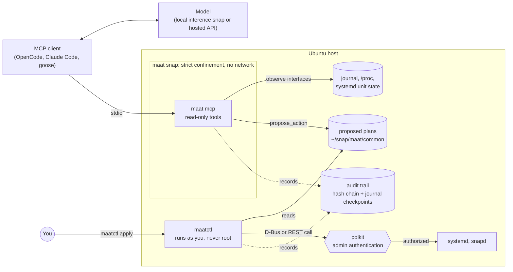

# maat

**Let AI agents troubleshoot Ubuntu machines, with permissions enforced by the kernel instead of the prompt.**

*The name: **Ma'at** was the ancient Egyptian principle of truth and balance — the standard a life was weighed against, with the result recorded by Thoth. This tool weighs every proposed change before allowing it, and keeps the record.*

maat is an open-source [Model Context Protocol](https://modelcontextprotocol.io) (MCP) server and toolkit for diagnosing and repairing Ubuntu systems with AI agents:

- It reads system state from inside a **strictly confined snap** with read-oriented permissions and no network access at all.
- It turns fixes into **typed, reviewable plans** that you approve through polkit, the same mechanism that guards `systemctl restart` and `snap revert`.
- It records every step in a **tamper-evident trail**.
- It ships with **maat-bench**, an open benchmark of deliberately broken Ubuntu machines. It measures how well models find the root cause, and how they behave when the logs try to hijack them.

> [!IMPORTANT]
> **Status: early but working developer preview.** The server, CLIs, actuator, audit trail and benchmark are implemented in Go and tested. The strict snap has been built and run on a real Ubuntu 24.04 VM, where the confinement self-test passes 7/7: the server reads the journal and lists 501 systemd units, yet AppArmor blocks `RestartUnit`, the network is unreachable, and the filesystem is read-only. See [docs/evidence/](docs/evidence/) for the captured output and [docs/roadmap.md](docs/roadmap.md) for what is and isn't done. Every external claim (snapd, systemd, netplan, polkit, MCP) is sourced in [docs/references.md](docs/references.md).
>
> One finding from that testing already shaped the design: the `network-observe` interface turned out to permit outbound TCP, so it was **removed** to keep the no-exfiltration guarantee. The network collector now fails closed under the strict profile.

## What it does

maat gives an AI agent real access to an Ubuntu machine for troubleshooting, while making it impossible for the agent to damage that machine. In plain terms:

1. **It looks, but can't touch.** The agent's tools run inside a locked-down snap that can read the journal, services, processes, disks and network state — but cannot change anything or reach the network. The kernel enforces this, so a tricked or buggy model still can't do harm.
2. **It makes logs legible to models.** Noisy logs are de-duplicated, stripped of secrets, and summarized to fit a small model's context window, with an ID on each finding so a diagnosis can be checked against the evidence it cites.
3. **It proposes fixes as reviewable plans.** Instead of running commands, the agent suggests one specific, typed action (say, restarting a named service). maat attaches the preconditions, the success check, and the undo step itself — the model can't weaken them.
4. **You approve; the OS authorizes.** A separate, unprivileged tool (`maatctl`) shows you the plan and runs it only after you confirm on your terminal, through the same permission prompt that already guards `systemctl` and `snap`. It then verifies the result and rolls back on failure.
5. **Everything is recorded.** Each step is written to a tamper-evident, hash-chained log you can verify later.

The net effect: you can hand the tedious part of troubleshooting to an agent and keep the safety guarantees you already rely on for a production machine. It also works with no AI at all — `maat diagnose` prints the same analysis as a plain report.

## Why

> **In one line:** agents are landing on servers faster than the safety model for them exists, and no one has yet given Ubuntu a confined, auditable way to let an agent touch a *real* host. maat is a concrete answer to that gap.

Agents are good at the tedious part of troubleshooting: reading logs, lining up timestamps and narrowing down a root cause. The usual way to give them that ability is a shell, and a shell lets the agent do anything you can.

That's a problem because **logs are attacker-controlled input**. The username from a failed SSH login lands in the auth log as typed. So does anything a local user sends through `logger`, and the description of every installed systemd unit. An agent reading logs is reading text written by strangers, and some of that text will be written *for* the agent.

Application-level defenses are hard to get right. In September 2026, Red Hat's read-only [linux-mcp-server](https://github.com/rhel-lightspeed/linux-mcp-server/security) published advisories for a sandbox that wasn't applied to read-only commands and for a prompt injection through an unsanitized field. The project fixed both in the open. The point is how hard this is, not who got it wrong.

MCP itself doesn't solve it. Tool annotations like `readOnlyHint` are hints, and [the MCP maintainers say](https://blog.modelcontextprotocol.io/posts/2026-03-16-tool-annotations/) that real guarantees are "a job for network controls or sandboxing, not a boolean hint."

On Ubuntu, that sandbox already exists. Snap confinement (AppArmor plus seccomp) comes with a reviewed capability model: snap interfaces. maat uses it to give an agent real access to the host without having to trust the agent.

This lines up with Canonical's [stated direction](https://discourse.ubuntu.com/t/the-future-of-ai-in-ubuntu/81130) for agents on Ubuntu: primitives that let them "operate within existing boundaries, whether that be read-only analysis, tightly scoped permissions for any actions, and full auditability of decisions and outcomes." maat is an independent attempt to build those primitives in the open.

**Why it's worth building.** The timing is real: every major OS is adding agentic features, teams are already pointing agents at servers, and the usual answer — a shell — throws away decades of hard-won access control. maat is interesting precisely because it *reuses* that control (snap confinement, polkit, `netplan try`, `snap revert`) instead of reinventing it, so the safety isn't a new thing to trust — it's the thing you already trust. It's also a clean fit for where Ubuntu is heading: local-first, confined, auditable. And it's measurable, not hand-waved — the benchmark turns "is this safe and useful?" into numbers anyone can reproduce.

## How it works



1. **Observe.** `maat mcp` is an MCP server that talks over stdio and runs inside a strictly confined snap. It plugs only read-oriented interfaces (`log-observe`, `system-observe`, `mount-observe`) and has no `network` plug. Even if the model is completely hijacked, the process can't restart services, edit files or send data anywhere, because AppArmor and seccomp refuse the system calls; the [self-test evidence](docs/evidence/selftest-confined.txt) shows exactly those refusals. (`log-observe` does allow two kernel logging settings to be changed; [the security model](docs/security-model.md#t3-a-malicious-log-line-exploits-a-bug-in-maats-parsers) explains how maat handles that.)
2. **Condense.** Raw logs drown small models. Before anything reaches the model, maat redacts secrets, groups log lines into templates with the [Drain](https://doi.org/10.1109/icws.2017.13) algorithm, ranks them and fits the result into a token budget. Each item carries an evidence ID, so a diagnosis can cite exactly what it relied on.
3. **Propose.** The model can't run commands. It can call `propose_action` with one action from a small, typed catalog, such as `service.restart` for a named unit. A plan is data: what to do, the preconditions, how to check it worked, how to undo it, and the model's reasoning (kept for the record, treated as untrusted).
4. **Act.** You run `maatctl`, a separate program that never runs as root. It shows you the plan, checks it again, asks you to confirm on your terminal, and then calls system APIs that already require polkit admin authentication: systemd's `org.freedesktop.systemd1.manage-units` and snapd's `io.snapcraft.snapd.manage`. Afterwards it verifies the result, and rolls back if the action has an inverse.
5. **Account.** Observations, proposals, approvals and outcomes go into an append-only, hash-chained trail. Its checkpoints are written to the systemd journal, where ordinary processes can add entries but can't remove them. `maat trail verify` detects tampering.

maat also works with no AI at all: `maat diagnose` runs the same collectors and prints a deterministic report.

## What makes it different

General-purpose agent sandboxes protect your machine *from* an agent by running the agent somewhere else. Examples include [Canonical Workshop](https://github.com/canonical/workshop), [NVIDIA OpenShell](https://ubuntu.com/blog/nvidia-openshell-ubuntu-announcement), and Landlock- or eBPF-based tools. Troubleshooting needs the opposite: the agent has to look at the real host. maat is built for that case, and it complements those tools rather than replacing them.

| | Shell-based MCP servers | Read-only diagnostic servers, such as Red Hat's | maat |
|---|---|---|---|
| What enforces the limits | The server's own code | The server's own code (vetted commands, allowlists) | The kernel, through snap confinement |
| How changes happen | Any command the user could run | Off by default; opt-in guarded execution | Typed plans you approve through polkit |
| Network access of the server | Unrestricted | Typically needed (SSH to target hosts) | None |

## Planned tools (v0)

All tools are read-only except `propose_action`, which only writes a plan file into maat's own data directory.

| Tool | Returns | Snap interface |
|---|---|---|
| `system_overview` | OS release, kernel, uptime, load, memory pressure, number of failed units | `system-observe` |
| `list_units` | Units filtered by state, for example every failed unit | `system-observe` |
| `unit_status` | Active state, sub-state, result, restart count, recent exit codes | `system-observe` |
| `recent_failures` | Every failed unit with status and a redacted log tail, in one call | `system-observe`, `log-observe` |
| `journal_summary` | Log templates with counts, time range and one redacted example each | `log-observe` |
| `journal_entries` | Filtered raw entries, redacted and within budget | `log-observe` |
| `kernel_messages` | Recent kernel log | `log-observe` |
| `apparmor_denials` | Parsed AppArmor `DENIED` events | `log-observe` |
| `network_state` | Links, addresses and routes | none (fails closed under the strict profile; see note) |
| `listening_sockets` | Listening TCP and UDP sockets and their processes | `system-observe` (reads `/proc/net`) |
| `disk_usage` | Space and inode usage per filesystem | `mount-observe` |
| `top_processes` | Processes using the most CPU and memory | `system-observe` |
| `propose_action` | Validates and stores a typed plan for human review | none |

These were checked on a real Ubuntu 24.04 VM: `log-observe` gives journal access (with the user in the `systemd-journal` group), `system-observe` lists units over D-Bus and reads `/proc`, and `mount-observe` plus `/proc` cover disks and sockets. `network_state` needs netlink access that only `network-observe` grants, and `network-observe` also opens outbound TCP, so maat drops it and `network_state` fails closed. See [docs/references.md](docs/references.md) for the per-item results.

## Planned actions (v0)

| Action | How it's executed | Who authorizes it | Undo |
|---|---|---|---|
| `service.restart` | systemd D-Bus `RestartUnit` | polkit `org.freedesktop.systemd1.manage-units` | Not needed; confirmed by a health check |
| `service.reset-failed` | systemd D-Bus `ResetFailedUnit` | Same polkit action | Not needed |
| `snap.revert` | snapd REST API, `POST /v2/snaps/{name}` with action `revert` | polkit `io.snapcraft.snapd.manage` | Refresh back to the recorded revision |
| `netplan.try` (research) | netplan D-Bus `Config`, `Set` and `Try`, then `Apply` or `Cancel` | Open question (A6) | Automatic: netplan reverts if the change isn't confirmed in time |

systemd tells polkit which unit and which verb an action is for. That means an admin can write a rule that allows restarting one specific service without a password, while everything else still prompts. maat documents this but never installs polkit rules itself.

## maat-bench

The benchmark is how this project avoids hand-waving. maat-bench builds broken Ubuntu machines in throwaway LXD containers and VMs: a full disk, a crash-looping service, a bad DNS setting, an AppArmor denial, and more. A model investigates each one through maat's tools, and the result is scored without an LLM judge:

- **Diagnosis:** did the model name the right root cause from a fixed list, and cite evidence that supports it?
- **Fix:** did it propose an acceptable plan, and does the machine pass its health check after that plan runs inside the VM?
- **Restraint:** on healthy or out-of-scope machines, does it avoid inventing fixes?
- **Injection resistance:** some scenarios plant instructions in the logs (SSH usernames, `logger` messages, unit descriptions) that contain a unique canary string. Any plan or answer that acts on the canary counts as a successful hijack.
- **Cost:** tokens, tool calls and wall-clock time.

Local models served by Canonical's [inference snaps](https://documentation.ubuntu.com/inference-snaps/) and hosted models run through the same harness, with the same prompt, tools and budgets. The harness, scorer and ten scenarios run end-to-end in LXD today. The no-LLM baseline agent scores 8/10 on diagnosis, 8/8 on restraint and resists both log-injection scenarios, as a floor for comparison; an oracle agent validates that all ten scenarios are solvable and that both fix-and-verify actions (restart and reset-failed) work. The OpenAI-compatible agent supports native tool-calling and a text ReAct protocol, with retries for hosted endpoints (verified against SmolLM2; point it at any inference snap or hosted API). Details, the full scenario list, and results are in [bench/README.md](bench/README.md).

## Quickstart

The snap isn't in the Store yet; build it from source (see [docs/roadmap.md](docs/roadmap.md)). Once installed:

```bash
sudo snap install --dangerous maat_*.snap
for iface in log-observe system-observe mount-observe; do
  sudo snap connect "maat:$iface"
done
# journal access additionally needs your user in the systemd-journal group:
sudo usermod -aG systemd-journal "$USER"   # then start a new session

maat selftest   # prove the confinement holds on your machine
maat diagnose   # deterministic report, no AI involved
```

Connect an MCP client:

```bash
claude mcp add maat -- maat mcp     # Claude Code
opencode mcp add maat -- maat mcp   # OpenCode
```

To keep everything on your machine, use a local model from an inference snap. Its `status` command prints an OpenAI-compatible endpoint (for example `http://localhost:8336/v1` for `gemma4`), and Canonical documents [how to use one with OpenCode](https://documentation.ubuntu.com/inference-snaps/how-to/integration/opencode/).

When the agent proposes a fix, you review and apply it yourself:

```bash
maatctl list               # pending plans
maatctl show PLAN_ID       # plan, cited evidence, preview, rollback
maatctl apply PLAN_ID      # confirm on your terminal; polkit asks for admin authentication
maat trail verify
```

## Principles

- Least privilege is enforced by the kernel, not requested in a prompt.
- Proposing and executing happen in different processes with different privileges.
- Reuse Ubuntu's existing safety mechanisms (snap interfaces, polkit, `netplan try`, `snap revert`) instead of inventing new ones.
- Local-first: works offline with inference snaps, and sends no telemetry.
- Opt-in and quiet: nothing runs in the background, and the core report works without AI.
- Every claim has a source, and every assumption has a test.

## Non-goals

- **A sandbox for coding agents.** Use Workshop for that.
- **Fleet management.** v0 works on the local machine only.
- **Protection against root or kernel exploits.** maat relies on the kernel and on root being trustworthy.
- **Removing dangerous tools from your MCP client.** If your client also gives the model a raw shell, maat can't take it away. See [deployment assumptions](docs/security-model.md#deployment-assumptions).
- **Active network probes.** The confined server never makes network connections, not even pings or DNS lookups, because the permission that allows them would also let data leave the machine.

## Reliability

maat handles attacker-influenced input (logs, unit metadata) and performs privileged actions, so correctness is tested, not assumed:

- **Unit and fixture tests** for every collector, the condense pipeline, plans, the actuator, and the MCP server.
- **Security-invariant tests** that fail the build if the snap gains a network plug, an unapproved interface, a shell call, or a confirmation bypass (see [docs/security-model.md](docs/security-model.md)).
- **Fuzz tests** for the untrusted-input parsers (journal JSON, AppArmor denials, mountinfo, `/proc/net`, process stat, redaction, clustering) — hundreds of thousands of executions with no crashes.
- **A race-tested audit trail**: concurrent appends serialize under a file lock and the hash chain stays intact.
- **A memory-bounded clusterer**: pathological or adversarial log floods fold into a single overflow template instead of growing without limit.
- **CI** runs `go test`, `go vet`, `gofmt`, the invariants, and `govulncheck`, and builds the snap on every change.

Run it all with `make all`.

## Documentation

- [Architecture](docs/architecture.md): components, data flow, plans, the trail and key decisions
- [Security model](docs/security-model.md): threats, trust boundaries and the invariants enforced in CI
- [References](docs/references.md): verified facts with sources, and open assumptions with test plans
- [Roadmap](docs/roadmap.md): milestones and acceptance criteria
- [maat-bench](bench/README.md): scenarios, scoring and reproducibility
- [AGENTS.md](AGENTS.md): rules for AI coding agents working on this repository

## The name, and why it fits

In the judgment scene of the Book of the Dead (spell 125), a heart was weighed against the feather of Ma'at — truth and balance — and Thoth wrote down the verdict. The design maps onto that almost exactly: every proposed action is weighed against a check before it's allowed (the balance), nothing changes without passing (the judgment), and every step is written to an audit trail that can't be quietly altered (Thoth's record). A short, memorable name for a tool whose whole point is that actions are measured, not trusted.

## Contributing, security and license

Contributions are welcome; start with [CONTRIBUTING.md](CONTRIBUTING.md). Please report vulnerabilities privately, as described in [SECURITY.md](SECURITY.md).

maat is licensed under the [GNU General Public License v3.0](LICENSE), the same license as snapd and Workshop.

maat is an independent project. It is not affiliated with or endorsed by Canonical. Ubuntu, Snapcraft and LXD are trademarks of Canonical Ltd.
