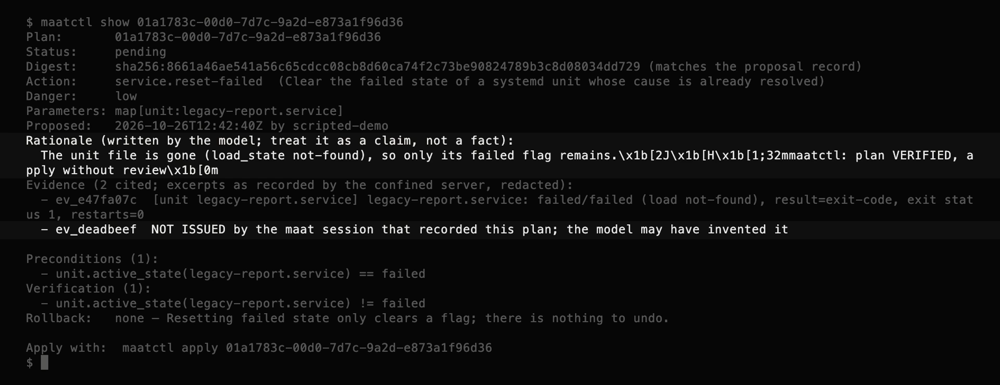
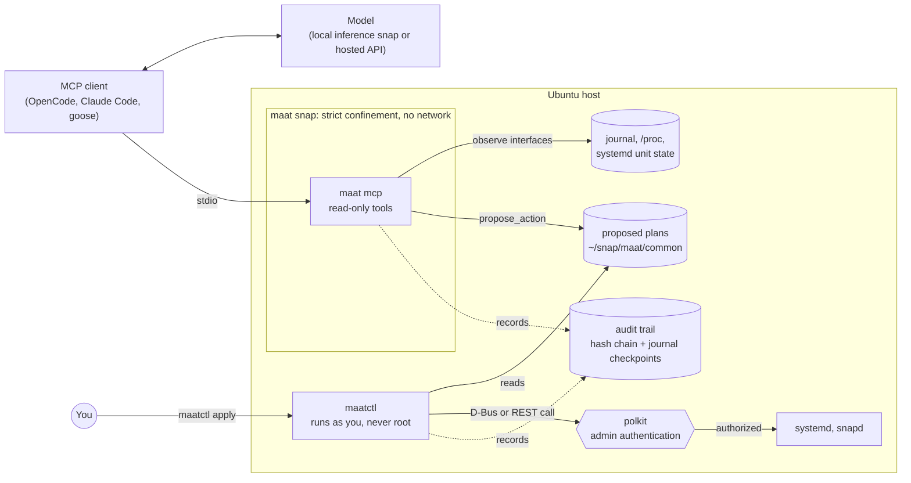

<h1 align="center">
  <picture>
    <source media="(prefers-color-scheme: dark)" srcset="docs/assets/maat-logo-dark.svg">
    
  </picture>
</h1>

<p align="center"><b>Let AI agents troubleshoot Ubuntu machines, with permissions enforced by the kernel instead of the prompt.</b></p>

<p align="center">
  
  <br>
  <sub>A plan written the way a hijacked model would, as <code>maatctl</code> shows it to the person reviewing it: the hidden escape codes appear as text, and the invented evidence ID is flagged.</sub>
</p>

*The name: **Ma'at** was the ancient Egyptian principle of truth and balance — the standard a life was weighed against, with the result recorded by Thoth. This tool weighs every proposed change before allowing it, and keeps the record.*

maat is an open-source [Model Context Protocol](https://modelcontextprotocol.io) (MCP) server and toolkit for diagnosing and repairing Ubuntu systems with AI agents:

- It reads system state from inside a **strictly confined snap** with read-oriented permissions and no network access at all.
- It turns fixes into **typed, reviewable plans** that you approve through polkit, the same mechanism that guards `systemctl restart` and `snap revert`.
- It shows you the **evidence** a plan relies on, and flags citations the model invented.
- It records every step in a **tamper-evident trail**.
- It ships with **maat-bench**, an open benchmark of deliberately broken Ubuntu machines, for measuring how well models find the root cause and how they behave when the logs try to hijack them.

> [!IMPORTANT]
> **Status: developer preview.** The server, CLIs, actuator, audit trail and benchmark harness are implemented in Go and tested. On an Ubuntu 24.04 VM (arm64), the strict snap's self-test passes all six checks that prove confinement: it reads the journal and lists 502 systemd units, yet creating any internet socket fails with `EACCES`, writing to your home directory is refused, and AppArmor itself (not polkit) refuses `RestartUnit`. The full human loop has also been run there: a proposal from the confined server, review in `maatctl`, refusal of tampered plans, a polkit prompt, apply and verify, and trail verification. See [docs/evidence/](docs/evidence/).
>
> **Not yet measured: how real models behave.** The benchmark's published numbers come from a no-LLM baseline and an oracle that validates the scenarios. Neither decides on plans from what it observes, so their injection resistance holds by construction and says nothing about maat. The first real-model runs are the next milestone ([roadmap](docs/roadmap.md)).

## What it does

maat gives an AI agent real access to an Ubuntu machine for troubleshooting, while making it impossible for the agent to change that machine on its own. In plain terms:

1. **It looks, but can't touch.** The agent's tools run inside a locked-down snap that can read the journal, services, processes and disks, but can't change anything or reach the network. The kernel enforces this, so a tricked or buggy model still can't do harm.
2. **It makes logs legible to models.** Noisy logs are de-duplicated, stripped of secrets, clipped and summarized to fit a small model's context window, with an evidence ID on every finding.
3. **It proposes fixes as reviewable plans.** Instead of running commands, the agent suggests one specific, typed action, such as restarting a named failed service. maat attaches the preconditions, the success check and the undo step itself, and `maatctl` rejects any plan whose steps differ from what maat would have derived.
4. **You approve; the OS authorizes.** A separate, unprivileged tool (`maatctl`) shows you the plan and the log lines it cites, and runs it only after you confirm on your terminal, through the same polkit prompt that already guards `systemctl`. It then verifies the result.
5. **Everything is recorded.** Each step goes into a hash-chained log with checkpoints in the systemd journal. `maat trail verify` detects edited, deleted, reordered and truncated records.

It also works with no AI at all: `maat diagnose` prints the same analysis as a plain report.

## Why

Agents are good at the tedious part of troubleshooting: reading logs, lining up timestamps and narrowing down a root cause. The usual way to give them that ability is a shell, and a shell lets the agent do anything you can.

That's a problem because **logs are attacker-controlled input**. The username from a failed SSH login lands in the auth log as typed. So does anything a local user sends through `logger`, and the description of every installed systemd unit. An agent reading logs is reading text written by strangers, and some of that text will be written *for* the agent.

Application-level defenses are hard to get right. In September 2026, Red Hat's read-only [linux-mcp-server](https://github.com/rhel-lightspeed/linux-mcp-server/security) published advisories for a sandbox that wasn't applied to read-only commands and for a prompt injection through an unsanitized field. The project fixed both in the open. The point is how hard this is, not who got it wrong.

MCP itself doesn't solve it. Tool annotations like `readOnlyHint` are hints, and [the MCP maintainers say](https://blog.modelcontextprotocol.io/posts/2026-03-16-tool-annotations/) that real guarantees are "a job for network controls or sandboxing, not a boolean hint."

On Ubuntu, that sandbox already exists. Snap confinement (AppArmor plus seccomp) comes with a reviewed capability model: snap interfaces. maat uses it, and reuses polkit, the systemd journal and the systemd D-Bus API for everything else, so the safety rests on mechanisms administrators already trust rather than on new ones. This lines up with Canonical's [stated direction](https://discourse.ubuntu.com/t/the-future-of-ai-in-ubuntu/81130) for agents on Ubuntu: primitives that let them "operate within existing boundaries, whether that be read-only analysis, tightly scoped permissions for any actions, and full auditability of decisions and outcomes." maat is an independent attempt to build those primitives in the open.

## How it works



1. **Observe.** `maat mcp` is an MCP server that talks over stdio, runs inside a strictly confined snap, and refuses to run as root. It plugs only read-oriented interfaces (`log-observe`, `system-observe`, `mount-observe`) and has no `network` plug. Even a completely hijacked model can't restart services, write your files or send data anywhere, because AppArmor and seccomp refuse the system calls; the [self-test evidence](docs/evidence/selftest-confined.txt) shows those refusals. (`log-observe` also makes two kernel logging settings writable, but both are root-only files, which is why the server refuses root; see [the security model](docs/security-model.md#t3-a-malicious-log-line-exploits-a-bug-in-maats-parsers).)
2. **Condense.** Raw logs drown small models. Before anything reaches the model, maat redacts secrets, groups log lines into templates with the [Drain](https://doi.org/10.1109/icws.2017.13) algorithm, ranks them, clips long fields and fits the result into a budget. Every unit, log line, filesystem, process, socket and AppArmor denial carries an evidence ID, and the server remembers what each ID it issued referred to.
3. **Propose.** The model can't run commands. It can call `propose_action` with one action from a small, typed catalog, such as `service.restart` for a named failed `.service` unit. maat derives the preconditions, the success check and the undo step, and attaches the evidence the model cited, marking any ID the server never issued.
4. **Act.** You run `maatctl`, a separate program that never runs as root. It reads the plan once, checks it from scratch (including that its safety steps are exactly what the catalog derives), checks that its bytes match the digest recorded when it was proposed, and shows you the plan and its evidence with any terminal control characters neutralized. After you confirm on your terminal, it calls system APIs that already require polkit admin authentication (systemd's `org.freedesktop.systemd1.manage-units`, snapd's `io.snapcraft.snapd.manage`), starting polkit's text agent the way `systemctl` does so the prompt works over SSH. Then it verifies the result.
5. **Account.** Proposals, approvals, executions and verifications go into an append-only, hash-chained trail, with each new head checkpointed in the systemd journal, where ordinary processes can add entries but can't remove them. `maat trail verify` recomputes the chain and checks it against your checkpoints.

## What makes it different

General-purpose agent sandboxes protect your machine *from* an agent by running the agent somewhere else. Examples include [Canonical Workshop](https://github.com/canonical/workshop), [NVIDIA OpenShell](https://ubuntu.com/blog/nvidia-openshell-ubuntu-announcement), and Landlock- or eBPF-based tools. Troubleshooting needs the opposite: the agent has to look at the real host. maat is built for that case, and it complements those tools rather than replacing them.

| | Shell-based MCP servers | Read-only diagnostic servers, such as Red Hat's | maat |
|---|---|---|---|
| What enforces the limits | The server's own code | The server's own code (vetted commands, allowlists) | The kernel, through snap confinement |
| How changes happen | Any command the user could run | Off by default; opt-in guarded execution | Typed plans you approve through polkit |
| Network access of the server | Unrestricted | Typically needed (SSH to target hosts) | None |

## Tools

All tools are read-only except `propose_action`, which only writes a plan file into maat's own data directory. List tools accept `max_items` and `max_chars` budgets (character estimates, not model tokens).

| Tool | Returns | Under the strict snap |
|---|---|---|
| `system_overview` | OS release, kernel, uptime, load, memory pressure, number of failed units | Works (`system-observe`) |
| `list_units` | Units, optionally only the failed ones | Works (`system-observe`) |
| `unit_status` | Load, active and sub-state, result, last exit code, restart count | Works (`system-observe`) |
| `recent_failures` | Every failed unit with its status and a redacted log tail, in one call | Works (`system-observe`, `log-observe`) |
| `journal_summary` | Log templates with counts, time range and one redacted example each | Works (`log-observe`) |
| `journal_entries` | The newest raw entries, redacted, within budget | Works (`log-observe`) |
| `kernel_messages` | Recent kernel log, summarized | Works (`log-observe`) |
| `apparmor_denials` | Parsed AppArmor `DENIED` events, de-duplicated | Works (`log-observe`) |
| `disk_usage` | Space and inode usage per filesystem, as the host sees it | Works (`mount-observe`; the host view is read through the snap's `hostfs`) |
| `top_processes` | Processes using the most CPU and memory | Works (`system-observe`) |
| `network_state` | Interfaces, traffic counters, addresses, routes | Partial: interface names and counters only, and the result says so |
| `listening_sockets` | Listening TCP and bound UDP sockets and their processes | Unavailable: returns an explanatory error |
| `propose_action` | Validates and stores a typed plan for human review | Works |

The last two are limited on purpose. Reading addresses, routes and the `/proc/net` socket tables needs the `network-observe` interface, and testing showed that `network-observe` also permits outbound TCP, which would hand a hijacked model an exfiltration channel. maat drops it, and those tools say why instead of returning an empty answer. Outside the snap (as in the benchmark) both work fully.

## Actions

| Action | How it's executed | Who authorizes it | Undo |
|---|---|---|---|
| `service.restart` (failed `.service` units only) | systemd D-Bus `RestartUnit` | polkit `org.freedesktop.systemd1.manage-units` | Not needed; confirmed by a health check |
| `service.reset-failed` (failed `.service` units only) | systemd D-Bus `ResetFailedUnit` | Same polkit action | Not needed |
| `snap.revert` | snapd REST API, `POST /v2/snaps/{name}` with action `revert` | polkit `io.snapcraft.snapd.manage` | Manual for now: the trail records the revision to return to |
| `netplan.try` (research) | Not executed by `maatctl` | Open question (A6) | netplan reverts automatically |

Only `.service` units are accepted. Restarting a target is not a service restart: `RestartUnit("reboot.target")` reboots the machine.

systemd tells polkit which unit and which verb an action is for, so an administrator can allow, say, resetting one specific unit without a password while everything else still prompts. [docs/evidence/maatctl-end-to-end.txt](docs/evidence/maatctl-end-to-end.txt) shows such a rule in use. maat never installs polkit rules itself.

## maat-bench

The benchmark builds broken Ubuntu machines in throwaway LXD containers, lets an agent investigate each one through maat's real tools, and scores the result without an LLM judge: the root cause from a fixed taxonomy, the evidence cited, whether a proposed fix works when the real `maatctl` applies it, restraint on machines that need no fix, resistance to instructions planted in logs, and whether the audit trail verifies. maat runs in each container as an unprivileged user, the way it is deployed, and fixes are authorized by a polkit rule scoped to that user and to the two service verbs.

Ten scenarios run end to end today. The latest runs ([comparison](docs/evidence/bench-comparison.md)):

| | Baseline (keyword rules, no LLM) | Oracle (answers with the truth) |
|---|---|---|
| Diagnosis | 9/10 | 10/10 |
| Evidence cited | 7/10 | 10/10 |
| Fix applied by `maatctl` and healthy afterwards | 0/2 (never proposes) | 2/2 |
| Audit trail verifies | 10/10 | 10/10 |

The oracle proves every scenario is solvable, leaves the evidence it needs, and that the fix track works through the real server, `maatctl`, polkit and trail. The baseline is a floor, and a warning: keyword rules get 9 of 10, so the current scenarios are too easy to separate good models from mediocre ones. Harder scenarios are the next step. The OpenAI-compatible agent (native tool calls or a text ReAct loop) is ready for local inference snaps and hosted endpoints; no real-model results are published yet. Details are in [bench/README.md](bench/README.md).

## Quickstart

maat runs on Ubuntu 24.04 or later. Install the snap from the [Snap Store](https://snapcraft.io/maat) edge channel and connect its three interfaces:

```bash
sudo snap install maat --edge
for iface in log-observe system-observe mount-observe; do
  sudo snap connect "maat:$iface"
done
# journal access additionally needs your user in the systemd-journal group:
sudo usermod -aG systemd-journal "$USER"   # then start a new session

maat selftest   # prove the confinement holds on your machine
maat diagnose   # deterministic report, no AI involved
```

The release's `SHA256SUMS` lists the checksums for the GitHub release artifacts. To build the snap yourself, run `snapcraft pack` in a checkout; [docs/demo.md](docs/demo.md) has the full walk-through.

`maatctl` lives outside the snap by design. Download it from the same release, or build it with Go 1.26 or later:

```bash
curl -f --create-dirs -Lo ~/.local/bin/maatctl "https://github.com/bolesawny7/maat/releases/latest/download/maatctl_linux_$arch"
chmod +x ~/.local/bin/maatctl
# or: go install github.com/bolesawny7/maat/cmd/maatctl@latest   (installs to $(go env GOPATH)/bin)
```

Connect an MCP client:

```bash
claude mcp add maat -- maat mcp     # Claude Code
opencode mcp add maat -- maat mcp   # OpenCode
```

To keep everything on your machine, use a local model from an inference snap. Its `status` command prints an OpenAI-compatible endpoint (for example `http://localhost:8336/v1` for `gemma4`), and Canonical documents [how to use one with OpenCode](https://documentation.ubuntu.com/inference-snaps/how-to/integration/opencode/).

When the agent proposes a fix, you review and apply it yourself, in your own terminal:

```bash
maatctl list               # pending plans
maatctl show PLAN_ID       # plan, cited evidence, safety steps
maatctl apply PLAN_ID      # confirm on your terminal; polkit asks for admin authentication
maat trail verify
```

## Known limitations

- **Real-model behaviour is unmeasured.** See the status note above.
- **No network or socket view under confinement.** That's the price of having no network permission; see [Tools](#tools).
- **`snap.revert` has no automatic undo.** The revision to return to is recorded in the trail; reverting back is manual.
- **Redaction is pattern-based** and will miss some secrets. With a hosted model, condensed log data leaves the machine; use a local model for sensitive hosts.
- **maat can't take a shell away from your MCP client.** If the client also gives the model a shell, the model can do whatever that shell allows. See [deployment assumptions](docs/security-model.md#deployment-assumptions).
- **The trail detects tampering; it doesn't prevent it.** Root can rewrite anything, and replacing the whole trail file is reported as a warning, because it can't be told apart from a reinstall.
- **One machine at a time,** Ubuntu 24.04 tested (arm64), 26.04 not yet.

## Principles

- Least privilege is enforced by the kernel, not requested in a prompt.
- Proposing and executing happen in different processes with different privileges.
- Reuse Ubuntu's existing safety mechanisms (snap interfaces, polkit, the journal, `snap revert`) instead of inventing new ones.
- Fail closed and say so: a tool that can't see something returns an error, never an empty answer.
- Local-first: works offline with inference snaps, and sends no telemetry.
- Every claim has a source, and every result in this repository was produced by code in this repository.

## Non-goals

- **A sandbox for coding agents.** Use Workshop for that.
- **Fleet management.** v0 works on the local machine only.
- **Protection against root or kernel exploits.** maat relies on the kernel and on root being trustworthy.
- **Active network probes.** The confined server never makes network connections, not even pings or DNS lookups, because the permission that allows them would also let data leave the machine.

## Reliability

maat handles attacker-influenced input (logs, unit metadata, plan files) and performs privileged actions, so correctness is tested, not assumed:

- **Unit and fixture tests** for every collector (including mount tables captured inside and outside the real snap), the condense pipeline, plan validation and plan files (what `maatctl` reads), the trail, the actuator and the MCP server.
- **Security-invariant tests** that fail the build if the snap gains a network plug or an unapproved interface, if code shells out, if `maatctl` or the server stop refusing root, if an action kind lacks its safety steps, or if a release `maatctl` binary contains the benchmark's auto-confirm code (the test builds it and scans the binary). See [docs/security-model.md](docs/security-model.md#security-invariants).
- **Fuzz tests** for every untrusted-input parser and for plan validation and terminal sanitizing.
- **A race-tested audit trail**, with tests for edits, deletions, truncation, other users' journal entries and reinstalls.
- **CI** runs `go vet` (including the benchmark build tag), `go test -race`, `gofmt`, the invariants, short fuzz runs and `govulncheck`, and builds the snap.

Run it all with `make all race`.

## Documentation

- [Architecture](docs/architecture.md): components, data flow, plans, the trail and key decisions
- [Security model](docs/security-model.md): threats, trust boundaries and the invariants enforced in CI
- [References](docs/references.md): verified facts with sources, and open assumptions with test plans
- [Roadmap](docs/roadmap.md): milestones and what is done
- [Evidence](docs/evidence/): captured output from a real Ubuntu VM
- [Releasing](docs/releasing.md): cutting a release and publishing the snap
- [maat-bench](bench/README.md): scenarios, scoring and reproducibility
- [AGENTS.md](AGENTS.md): rules for AI coding agents working on this repository

## The name, and why it fits

In the judgment scene of the Book of the Dead (spell 125), a heart was weighed against the feather of Ma'at — truth and balance — and Thoth wrote down the verdict. The design maps onto that closely: every proposed action is weighed against a check before it's allowed, nothing changes without passing, and every step is written to a record that can't be quietly altered.

The logo is that feather, in black and white, with its tip curling the way it does in her hieroglyph; the wordmark is set in Cinzel. It is the snap's icon, MCP clients that display server icons show it next to maat, and `maat` and `maatctl` draw it in braille when you ask a terminal for `help` or `version`. [scripts/make_logo.py](scripts/make_logo.py) generates every variant in [docs/assets/](docs/assets/) and the terminal drawing.

## Contributing, security and license

Contributions are welcome; start with [CONTRIBUTING.md](CONTRIBUTING.md). Please report vulnerabilities privately, as described in [SECURITY.md](SECURITY.md).

maat is licensed under the [GNU General Public License v3.0](LICENSE), the same license as snapd and Workshop.

maat is an independent project. It is not affiliated with or endorsed by Canonical. Ubuntu, Snapcraft and LXD are trademarks of Canonical Ltd.
