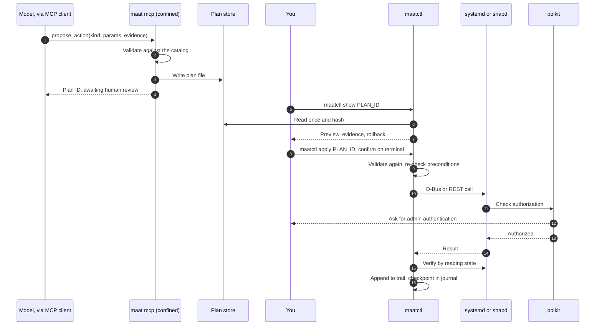

# Architecture

This document describes how maat fits together and why each piece is shaped the way it is. The server, CLIs, actuator, trail and benchmark are implemented in Go and tested; a few items (for example `netplan.try` execution and automated `snap.refresh` rollback) are still marked research or left to the operator, and are called out where they appear. Facts are cited as F-numbers and open questions as A-numbers; both are defined in [references.md](references.md).

## Goals

1. Give an agent useful visibility into a real Ubuntu host.
2. Make it impossible for the model-facing process to change services, files or configuration, or to reach the network, enforced by the kernel rather than by maat's own code.
3. Allow changes only as typed plans that a person approves through the operating system's own authorization service, polkit.
4. Make every step auditable, and make tampering with the record detectable.
5. Work well with small local models, not only with large hosted ones.
6. Back every claim about quality and safety with a measurement from maat-bench.

## Overview

maat has three parts:

- **The server** (`maat`, shipped as a strictly confined snap) collects system state, condenses it for a model, serves it over MCP and records proposed plans.
- **The actuator** (`maatctl`, shipped outside the snap) shows plans to a person and executes the ones they approve.
- **The benchmark** (`bench/`) builds broken machines in LXD and measures how models do with the first two.

The server and the actuator share two things under `~/snap/maat/common`: the plan store and the trail.

The life of one fix, from proposal to audit record:



## The server

### Commands

| Command | Purpose |
|---|---|
| `maat mcp` | MCP server over stdio |
| `maat diagnose` | Runs the collectors and prints a deterministic report, with no model involved |
| `maat plans` | Lists the plans the server has recorded |
| `maat trail verify` | Checks the trail's hash chain against its journal checkpoints |

### Confinement

The snap uses strict confinement. Every plug below is manual-connect, and none is in the Snap Store's super-privileged category (F1).

| Interface | Why maat needs it | What it grants, according to snapd's source |
|---|---|---|
| `log-observe` | Journal, `/var/log`, kernel log | Read `/var/log/**`, `/run/log/journal/**` and `/dev/kmsg`, and run `journalctl`. Also write access to `kernel.printk_ratelimit` and to AppArmor's audit setting, plus the `dac_override` and `dac_read_search` capabilities (F3). |
| `system-observe` | Processes and systemd unit state | `ptrace (read)`, most of `/proc`, and systemd D-Bus property reads plus `GetUnit` and `ListUnits`. Nothing that controls units (F2). It does **not** cover `/proc/<pid>/net/tcp` and the other socket tables, so listening sockets can't be read under the snap; `/proc/net/dev` (interface counters) is readable (F31). |
| `mount-observe` | Mount table and quotas | Read mount and quota information (F1). Inside the snap the mount table is the snap's own namespace; the host's mounts appear under `/var/lib/snapd/hostfs` (F34). |

Deliberately left out:

- **`network`.** The server never opens a network connection, so a hijacked model has no channel to send data out. The MCP client talks to the model; maat doesn't. Confirmed in the VM: without this plug, an outbound connect fails with `socket: permission denied` (F28, A2).
- **`network-observe`.** It would power the `network_state` and `listening_sockets` tools, but testing showed it also permits *outbound* TCP, which would reopen the exfiltration channel (F28). It is excluded: under the snap `network_state` reports only interface names and counters, and `listening_sockets` returns an explanatory error. An invariant test keeps the plug out.
- **`snap-refresh-observe`.** A confined app needs it (or one of two other interfaces) to read snap metadata from snapd (F10), but it's super-privileged (F5). v0 infers snap health from `snap.*` systemd units and snapd's journal entries instead. `maatctl` runs outside the snap and can read snap metadata without authentication (F10), so its previews do show revisions.
- **`hardware-observe` and `network-setup-observe`.** Candidates for later tools. A plug is added only together with a tool that needs it, and only after the security model is updated.

`log-observe` is not purely read-only (F3). Both settings it makes writable are files only root can write, and `maat mcp` refuses to run as root, so ordinary file permissions keep even a compromised server away from them. maat's code never references them either, and a test enforces that.

### State on disk

Writable state lives in `$SNAP_USER_COMMON`, which is `~/snap/maat/common`. It's shared across snap revisions and isn't rolled back by `snap revert` (F7). That matters: the trail has to survive a revert.

```
~/snap/maat/common/
├── config.yaml
├── plans/<plan-id>.json
└── trail/trail.jsonl
```

### Collectors

Each collector reads one source, through a typed API or a program run with a fixed argument list. No collector ever passes a string to a shell.

| Collector | Source | Mechanism |
|---|---|---|
| Journal | systemd journal | `journalctl --output=json` with fixed flags; needs the user in `systemd-journal` (F30) |
| Units | systemd | D-Bus `ListUnits`, `GetUnit` and property reads on `org.freedesktop.systemd1`, using godbus (F2, F9) |
| Kernel | journal | `journalctl -k` |
| AppArmor | journal | Kernel and audit messages containing `apparmor="DENIED"`; D-Bus denials name the profile in `label=` |
| Processes | `/proc` | Direct read (F2) |
| Network | `ip -j` and `/proc/net/dev` | Full view outside the snap; under the snap only `/proc/net/dev` is readable, so the result is marked limited (F31) |
| Sockets | `/proc/net/{tcp,tcp6,udp,udp6}` | Outside the snap only; under the snap the tool fails closed (F31) |
| Filesystems | Mount table and `statfs` | One row per filesystem (bind mounts collapse by device number); under the snap the host's mounts are read from `/var/lib/snapd/hostfs` and shown with their host paths (F34) |

Collectors are unit-tested against recorded fixtures, including mount tables captured inside and outside the real snap. Nothing in the unit test suite touches the live system.

### The condense pipeline

Every tool result goes through the same stages before the model sees it:

1. **Normalize** into typed records: timestamp, source, unit, priority, message.
2. **Redact** secrets: credentials embedded in URLs, bearer tokens, private key blocks, common API key formats, and patterns the user adds. Redaction is best-effort, which is why a local model is the recommended setup for sensitive machines.
3. **Fence untrusted text.** Text that came from logs or unit metadata is returned in clearly labelled data fields and never spliced into instructions. This reduces prompt-injection risk but can't eliminate it. Confinement and human approval are what actually contain it.
4. **Cluster** log lines into templates with Drain (F25). Four thousand "connection refused" lines become one template with a count, first and last timestamps, and one redacted example.
5. **Rank** by severity, recency and closeness to failing units.
6. **Budget.** Every text field is clipped (journald accepts lines of tens of kilobytes), and list tools accept `max_items` and `max_chars`. Output is trimmed to fit, most important first, and marked `truncated`. Sizes are character estimates, not model tokens. Paging is not implemented.

Every record also gets an **evidence ID**, a short hash of what identifies it: a unit name, a log template, a mount point. The server remembers what each ID it issued referred to (bounded, oldest first out). When the model proposes a plan, the server attaches a redacted excerpt for each cited ID and marks the IDs it never issued, so `maatctl show` displays the evidence itself and flags invented citations. A template's ID can change as Drain merges more lines into it, so IDs are stable within a session, not across queries.

### MCP surface

- **Transport:** stdio only. Without a listening socket, there's nothing to authenticate and nothing exposed to the network.
- **SDK:** the official Go SDK, `github.com/modelcontextprotocol/go-sdk`, v1.8 or later. It speaks protocol revision 2026-07-28 and falls back to 2025-11-25 and earlier for older clients (F15).
- **Features:** tools only. maat doesn't use sampling, roots or logging, all three of which are deprecated in revision 2026-07-28 (F15).
- **Annotations:** set honestly but treated as hints for clients, never as enforcement (F16). Every observer tool sets `readOnlyHint: true`. `propose_action` sets `readOnlyHint: false` and `destructiveHint: false`, because it only adds a file.
- **Results:** structured content plus a short text summary.
- **Identity:** the server sends a title, a description and a 64-pixel PNG icon as a data URI in its `initialize` response; it can't link to an image, having no network. Tool results identify the server in `_meta` (SEP-2575) without the icon, so it isn't repeated in every response.

## Plans

A plan is a JSON document with a versioned schema (`maat.plan/v0`). This one was recorded by the confined server during the [end-to-end run](evidence/maatctl-end-to-end.txt); only its rationale is shortened here (the real one tried to repaint the reviewer's terminal):

```json
{
  "schema": "maat.plan/v0",
  "id": "01a177e3-1339-7b7e-88c8-d2cf1aed91fd",
  "kind": "service.reset-failed",
  "params": { "unit": "maat-stale.service" },
  "preconditions": [
    { "type": "unit.active_state", "unit": "maat-stale.service", "equals": "failed" }
  ],
  "verify": [
    { "type": "unit.active_state", "unit": "maat-stale.service", "not_equals": "failed", "within_seconds": 10 }
  ],
  "rollback": { "kind": "none", "reason": "Resetting failed state only clears a flag; there is nothing to undo." },
  "evidence": ["ev_f1bd9337", "ev_deadbeef"],
  "evidence_detail": [
    { "id": "ev_f1bd9337", "source": "unit", "subject": "maat-stale.service",
      "excerpt": "maat-stale.service: failed/failed (load not-found), result=exit-code, exit status 1, restarts=0" }
  ],
  "rationale": "The unit file is gone (load_state not-found), so only its failed flag remains. …",
  "created_at": "2026-10-26T11:05:32.729972036Z",
  "proposer": { "client": "demo" }
}
```

Rules:

- **The catalog is closed.** Unknown kinds are rejected when proposed, and again when applied.
- **Parameters are validated per kind.** A unit must be a valid `.service` unit name (whether it is loaded and failed is a precondition checked against the live system); a snap name must follow snap naming rules.
- **The safety steps belong to the catalog.** `maatctl` re-derives the preconditions, verification and rollback from the kind and parameters and rejects the plan if the file's differ, so a plan edited on disk can't weaken them.
- **Model-supplied text is bounded:** at most 32 evidence IDs, each of the `ev_…` form, and a rationale of at most 4,000 bytes.
- **Validation happens twice.** The server validates so the model gets fast feedback. `maatctl` validates again from scratch, because it can't trust anything the server wrote.
- **IDs are UUIDv7** (RFC 9562), so plans sort by creation time.

## The actuator: `maatctl`

`maatctl` runs as the person who invokes it, outside snap confinement. It has to live outside the snap for three reasons:

- No snap interface lets a confined app restart host units; `system-observe` allows only reads (F2).
- `snapd-control` is generally limited to brand stores (F5).
- The Snap Store lists management tools as unsupported for classic confinement (F6).

Packaging is still open. The candidates are a Debian package in a Launchpad PPA, and plain release binaries; until then it is built from source.

### Apply flow

1. Refuse to run as root, so that polkit stays the gatekeeper and the trail records a real person.
2. Read the plan file once into memory, compute the SHA-256 digest of its bytes, and work only from that copy.
3. Validate it from scratch: schema, UUID, catalog membership, parameters, bounded model text, and safety steps equal to what the catalog derives.
4. Find the plan's proposal record in the trail and require its digest to match. A plan with no proposal record, a different digest, or an outcome already recorded (applied or rejected) is refused.
5. Show the action, parameters, danger level, rollback and digest, and check the preconditions.
6. Ask for confirmation on the controlling terminal (`/dev/tty`) rather than standard input, so a non-interactive caller can't answer on your behalf. The plan ID must be typed.
7. Re-check the preconditions, to close the window between review and execution, and record the approval. If the approval can't be recorded, nothing happens.
8. Start polkit's text agent (`/usr/bin/pkttyagent --notify-fd 3 --fallback`, as `systemctl` does) on the terminal, and call the service's API. polkit decides whether to ask for admin authentication (F8, F10, F33). With `--fallback`, a desktop agent the session already has takes precedence.
9. Run the verification steps. If they fail and the action kind has an inverse, run it.
10. Record execution, verification and any rollback. A record that fails after the approval is reported and makes the command exit non-zero.

`maatctl show` prints everything that came from the plan file (the rationale, the proposer, evidence excerpts) with control characters, bidirectional overrides and invalid UTF-8 escaped, so a plan can't repaint the reviewer's terminal.

### Action catalog (v0)

| Kind | API call | polkit action | Verification | Rollback |
|---|---|---|---|---|
| `service.restart` | `org.freedesktop.systemd1.Manager.RestartUnit(name, "replace")` (F9) | `org.freedesktop.systemd1.manage-units`, verb `restart` (F8) | Unit reaches `active` within 30 seconds | None needed |
| `service.reset-failed` | `Manager.ResetFailedUnit(name)` (F9) | Same action, verb `reset-failed` (F8) | Unit is no longer `failed`; a unit systemd unloaded counts as inactive (F35) | None needed |
| `snap.revert` | snapd `POST /v2/snaps/{name}` with `{"action": "revert"}` (F10) | `io.snapcraft.snapd.manage` (F10) | The snap's services are active | Not automated: the execution record names the revision reverted from |
| `netplan.try` (research) | Not executed | Unknown (A6) | Connectivity check from the host | Automatic: netplan reverts if the change isn't confirmed (F12) |

Both service actions accept only `.service` units, and `service.restart` requires the unit to be `failed`.

Because systemd passes the unit and verb to polkit (F8), an admin can allow, say, resetting one unit without a password while everything else still asks; [the end-to-end evidence](evidence/maatctl-end-to-end.txt) shows such a rule. maat never installs rules itself.

The benchmark needs to apply plans without a person at a terminal. That capability exists only in builds with the Go build tag `maatbench` (`cmd/maatctl/confirm_bench.go`), which take the confirmation from the harness instead of the terminal. Release builds don't contain it: an invariant test builds `maatctl` both ways and checks the release binary for the benchmark-only strings.

## The trail

Each record is one line of JSON:

```json
{"seq":42,"ts":"2026-10-25T21:03:11Z","type":"approval","actor":"maatctl","plan":"01a174dc-f480-7cc4-9a51-2f0d8a1b6e3d","digest":"sha256:...","prev":"sha256:...","hash":"sha256:..."}
```

- `hash` is SHA-256 over `prev` and the canonical JSON of the record without `hash`.
- Records hold digests and redacted summaries, never raw log text.
- The server and `maatctl` both append, under an advisory file lock.
- **Checkpoints.** After every append, the writer records the trail's ID (the hash of its first record), the new `seq` and its `hash` in the systemd journal with `logger --journald`, which works from inside the strict snap (F32). Unprivileged processes can add journal entries but can't delete them, so rewriting history leaves old checkpoints that no longer match.
- **Verification.** `maat trail verify` recomputes the chain and checks it against the checkpoints whose journald-assigned `_UID` is the current user's; any local user can write entries with maat's field names, but not with someone else's `_UID` (F14). For this trail's ID, a different hash for a recorded `seq`, two hashes for one `seq`, or a checkpoint beyond the file's last record (truncation) is reported as tampering. Checkpoints of a different trail ID are reported as warnings: they're what a reinstall leaves behind, and also what replacing the whole file looks like.
- **Limits.** Replacing the entire trail is reported, not prevented, and only as a warning. Checkpoints older than the journal's retention period can't be checked, and root can rewrite anything. journald's trusted `_EXE` and `_CMDLINE` fields would say which program wrote a checkpoint, but they are often missing for a short-lived `logger` process (F32), so the trail doesn't rely on them. Admins who need protection against later tampering by root can enable journald's Forward Secure Sealing (F13).

## The benchmark harness

The harness lives in `bench/` and runs on the host, not in the snap. It drives LXD, contains its own minimal agent loop so that results don't depend on any particular MCP client, and talks to models through OpenAI-compatible endpoints (F18). Inside each container maat runs unconfined but as an unprivileged user in `systemd-journal`, and fixes are applied by the `maatbench` build of `maatctl` under a polkit rule scoped to that user (F36). The design is in [bench/README.md](../bench/README.md).

## Repository layout

```
cmd/maat/            server and CLI, shipped in the snap
cmd/maatctl/         plan review and execution, shipped outside the snap
internal/collect/    journal, systemd, /proc, network, filesystems, AppArmor
internal/condense/   redaction, Drain clustering, ranking, clipping, budgets
internal/mcpserver/  tool definitions and handlers, evidence registry
internal/plan/       schema, catalog, validation
internal/planstore/  plan files and their digests
internal/actuate/    checks, execution and rollback for each action kind
internal/trail/      hash chain, locking, journal checkpoints, verification
internal/termsafe/   rendering untrusted text for a terminal
internal/selftest/   confinement probes
internal/report/     maat diagnose
bench/               scenarios, harness, scoring, results
snap/snapcraft.yaml  strict confinement and plugs
scripts/             VM setup and the end-to-end demo
docs/
```

## Key decisions

**Go.** It's the language of snapd, LXD and Pebble, it produces static binaries that are easy to confine, and it has an official MCP SDK (F15).

**A strict snap for the server.** Confinement is enforced by the kernel and reviewed by the Snap Store, and users can see and revoke every permission with `snap connections maat`. Two alternatives were considered:

- Landlock self-sandboxing is promising as an extra layer, but it needs testing inside the snap's seccomp profile (A13).
- eBPF LSM enforcement, as in MCPGuard-Dynamic, requires enabling the BPF LSM at boot (F24), which most machines don't do.

**The actuator outside the snap.** Snap policy and interface design require it (F2, F5, F6). It's the better design anyway: the process that proposes and the process that executes should have different privileges.

**polkit instead of a custom approval system.** systemd and snapd already ask polkit before changing anything (F8, F10). Admins already know how to configure it, and it can be scoped to a single unit and verb. maat adds review, verification and rollback around polkit rather than building a second gatekeeper.

**A closed action catalog instead of free-form commands.** Typed actions can be previewed, validated, verified, undone and scored. Free-form commands can't.

**stdio only.** With no listening socket, there's no authentication to get wrong.

**Deterministic scoring.** Diagnoses are structured, as a label from a fixed taxonomy plus evidence IDs, so the benchmark doesn't need one LLM to grade another.

**Local-first.** Inference snaps provide OpenAI-compatible endpoints (F18), so the private, offline setup is also the easy one.

## Platforms

Ubuntu 24.04 LTS and 26.04 LTS on amd64 and arm64. So far everything has been run on 24.04 arm64; 26.04 and amd64 are untested. The snap uses base `core24` and the `go` build snap (A15, decided), targeting the supported Go releases (F19).
