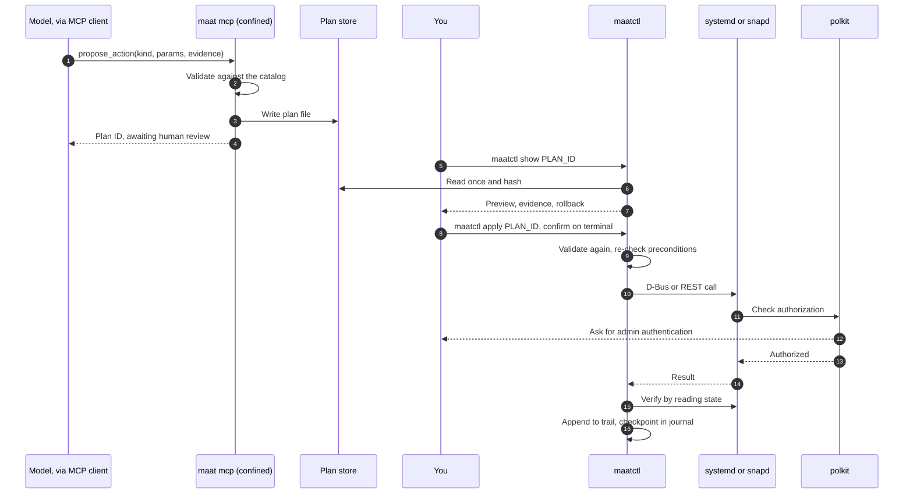

# Architecture

This document describes how maat fits together and why each piece is shaped the way it is. The server, CLIs, actuator, trail and benchmark are implemented in Go and tested; a few items (for example `netplan.try` execution and automated `snap.refresh` rollback) are still marked research or left to the operator, and are called out where they appear. Facts are cited as F-numbers and open questions as A-numbers; both are defined in [references.md](references.md).

## Goals

1. Give an agent useful visibility into a real Ubuntu host.
2. Make it impossible for the model-facing process to change services, files or configuration, or to reach the network, enforced by the kernel rather than by maat's own code.
3. Allow changes only as typed plans that a person approves through the operating system's own authorization service, polkit.
4. Make every step auditable, and make tampering with the record detectable.
5. Work well with small local models, not only with large hosted ones.
6. Back every claim about quality and safety with a measurement from maat-bench.

## Overview

maat has three parts:

- **The server** (`maat`, shipped as a strictly confined snap) collects system state, condenses it for a model, serves it over MCP and records proposed plans.
- **The actuator** (`maatctl`, shipped outside the snap) shows plans to a person and executes the ones they approve.
- **The benchmark** (`bench/`) builds broken machines in LXD and measures how models do with the first two.

The server and the actuator share two things under `~/snap/maat/common`: the plan store and the trail.

The life of one fix, from proposal to audit record:



## The server

### Commands

| Command | Purpose |
|---|---|
| `maat mcp` | MCP server over stdio |
| `maat diagnose` | Runs the collectors and prints a deterministic report, with no model involved |
| `maat plans` | Lists the plans the server has recorded |
| `maat trail verify` | Checks the trail's hash chain against its journal checkpoints |

### Confinement

The snap uses strict confinement. Every plug below is manual-connect, and none is in the Snap Store's super-privileged category (F1).

| Interface | Why maat needs it | What it grants, according to snapd's source |
|---|---|---|
| `log-observe` | Journal, `/var/log`, kernel log | Read `/var/log/**`, `/run/log/journal/**` and `/dev/kmsg`, and run `journalctl`. Also write access to `kernel.printk_ratelimit` and to AppArmor's audit setting, plus the `dac_override` and `dac_read_search` capabilities (F3). |
| `system-observe` | Processes and systemd unit state | `ptrace (read)`, most of `/proc`, and systemd D-Bus property reads plus `GetUnit` and `ListUnits`. Nothing that controls units (F2). Also reads `/proc/net/*`, which covers listening sockets. |
| `mount-observe` | Mount table and quotas | Read mount and quota information (F1) |

Deliberately left out:

- **`network`.** The server never opens a network connection, so a hijacked model has no channel to send data out. The MCP client talks to the model; maat doesn't. Confirmed in the VM: without this plug, an outbound connect fails with `socket: permission denied` (F28, A2).
- **`network-observe`.** It would power the `network_state` tool, but testing showed it also permits *outbound* TCP, which would reopen the exfiltration channel (F28). It is excluded, and `network_state` fails closed as a result. An invariant test keeps it out.
- **`snap-refresh-observe`.** A confined app needs it (or one of two other interfaces) to read snap metadata from snapd (F10), but it's super-privileged (F5). v0 infers snap health from `snap.*` systemd units and snapd's journal entries instead. `maatctl` runs outside the snap and can read snap metadata without authentication (F10), so its previews do show revisions.
- **`hardware-observe` and `network-setup-observe`.** Candidates for later tools. A plug is added only together with a tool that needs it, and only after the security model is updated.

`log-observe` is not purely read-only (F3). maat's code never writes to those two settings, a test enforces that, and [the security model](security-model.md) lists it as a residual risk.

### State on disk

Writable state lives in `$SNAP_USER_COMMON`, which is `~/snap/maat/common`. It's shared across snap revisions and isn't rolled back by `snap revert` (F7). That matters: the trail has to survive a revert.

```
~/snap/maat/common/
├── config.yaml
├── plans/<plan-id>.json
└── trail/trail.jsonl
```

### Collectors

Each collector reads one source, through a typed API or a program run with a fixed argument list. No collector ever passes a string to a shell.

| Collector | Source | Planned mechanism |
|---|---|---|
| Journal | systemd journal | `journalctl --output=json` with fixed flags (A1) |
| Units | systemd | D-Bus `ListUnits`, `GetUnit` and property reads on `org.freedesktop.systemd1`, using godbus (F2, F9, A3) |
| Kernel | `/dev/kmsg` | Direct read (F3) |
| AppArmor | Journal | Kernel messages containing `apparmor="DENIED"` (A12) |
| Processes | `/proc` | Direct read (F2) |
| Network | netlink or `/proc/net` | Decided in M0 (A8) |
| Filesystems | Mount table and `statfs` | Decided in M0 (A8) |

Collectors are unit-tested against recorded fixtures. Nothing in the unit test suite touches the live system.

### The condense pipeline

Every tool result goes through the same stages before the model sees it:

1. **Normalize** into typed records: timestamp, source, unit, priority, message.
2. **Redact** secrets: credentials embedded in URLs, bearer tokens, private key blocks, common API key formats, and patterns the user adds. Redaction is best-effort, which is why a local model is the recommended setup for sensitive machines.
3. **Fence untrusted text.** Text that came from logs or unit metadata is returned in clearly labelled data fields and never spliced into instructions. This reduces prompt-injection risk but can't eliminate it. Confinement and human approval are what actually contain it.
4. **Cluster** log lines into templates with Drain (F25). Four thousand "connection refused" lines become one template with a count, first and last timestamps, and one redacted example.
5. **Rank** by severity, recency and closeness to failing units.
6. **Budget.** Every tool accepts `max_tokens`. Output is trimmed to fit, marked `truncated`, and can be paged with a cursor. Counts are character-based estimates unless a model-specific tokenizer is configured.

Every record also gets an **evidence ID**, a short hash of its source and position. Diagnoses cite evidence IDs, the benchmark scores them, and `maatctl` shows them next to a plan so you can check the reasoning against the raw data.

### MCP surface

- **Transport:** stdio only. Without a listening socket, there's nothing to authenticate and nothing exposed to the network.
- **SDK:** the official Go SDK, `github.com/modelcontextprotocol/go-sdk`, v1.8 or later. It speaks protocol revision 2026-07-28 and falls back to 2025-11-25 and earlier for older clients (F15).
- **Features:** tools only. maat doesn't use sampling, roots or logging, all three of which are deprecated in revision 2026-07-28 (F15).
- **Annotations:** set honestly but treated as hints for clients, never as enforcement (F16). Every observer tool sets `readOnlyHint: true`. `propose_action` sets `readOnlyHint: false` and `destructiveHint: false`, because it only adds a file.
- **Results:** structured content plus a short text summary.

## Plans

A plan is a JSON document checked against a versioned schema. This example is illustrative; the schema is finalized in M3.

```json
{
  "schema": "maat.plan/v0",
  "id": "01a174dc-f480-7cc4-9a51-2f0d8a1b6e3d",
  "kind": "service.restart",
  "params": { "unit": "nginx.service" },
  "preconditions": [
    { "check": "unit.active_state", "unit": "nginx.service", "equals": "failed" }
  ],
  "verify": [
    { "check": "unit.active_state", "unit": "nginx.service", "equals": "active", "within_seconds": 30 }
  ],
  "rollback": { "kind": "none", "reason": "A restart leaves no persistent change." },
  "evidence": ["ev_7c1e09", "ev_91aa3f"],
  "rationale": "Model-written text. Shown to the reviewer verbatim, never executed.",
  "created_at": "2026-10-25T21:00:00Z",
  "proposer": { "client": "opencode", "model": "gemma4-e4b-q4-k-m" }
}
```

Rules:

- **The catalog is closed.** Unknown kinds are rejected when proposed, and again when applied.
- **Parameters are validated per kind.** For example, a unit name must be a valid systemd unit name for a loaded unit, and a snap name must follow snap naming rules.
- **Validation happens twice.** The server validates so the model gets fast feedback. `maatctl` validates again from scratch, because it can't trust anything the server wrote.
- **IDs are UUIDv7** (RFC 9562), so plans sort by creation time.

## The actuator: `maatctl`

`maatctl` runs as the person who invokes it, outside snap confinement. It has to live outside the snap for three reasons:

- No snap interface lets a confined app restart host units; `system-observe` allows only reads (F2).
- `snapd-control` is generally limited to brand stores (F5).
- The Snap Store lists management tools as unsupported for classic confinement (F6).

Packaging is decided in M4. The candidates are a Debian package in a Launchpad PPA, and plain release binaries.

### Apply flow

1. Refuse to run as root, so that polkit stays the gatekeeper and the trail records a real person.
2. Read the plan file once into memory, compute its SHA-256 digest, and work only from that copy.
3. Validate the schema, catalog membership and parameters again.
4. Show a preview: what will change, the current state, the cited evidence, the verification step and the rollback.
5. Ask for confirmation on the controlling terminal (`/dev/tty`) rather than standard input, so a non-interactive caller can't answer on your behalf.
6. Re-check the preconditions immediately before executing, to close the window between review and execution.
7. Call the service's API. polkit decides whether to ask for admin authentication (F8, F10). Terminal sessions need a polkit text agent, the way `systemctl` uses one (A7).
8. Run the verification steps. If they fail and the action kind has an inverse, run it.
9. Append approval, execution, verification and rollback records to the trail.

### Action catalog (v0)

| Kind | API call | polkit action | Verification | Rollback |
|---|---|---|---|---|
| `service.restart` | `org.freedesktop.systemd1.Manager.RestartUnit(name, "replace")` (F9) | `org.freedesktop.systemd1.manage-units`, verb `restart` (F8) | Unit reaches `active` within the plan's time limit | None needed |
| `service.reset-failed` | `Manager.ResetFailedUnit(name)` (F9) | Same action, verb `reset-failed` (F8) | Unit is no longer `failed` | None needed |
| `snap.revert` | snapd `POST /v2/snaps/{name}` with `{"action": "revert"}` (F10) | `io.snapcraft.snapd.manage` (F10) | The snap's services are active | Refresh back to the recorded revision |
| `netplan.try` (research) | netplan D-Bus `Config`, `Set`, `Try(timeout)`, then `Apply` or `Cancel` (F11) | Unknown (A6) | Connectivity check from the host | Automatic: netplan reverts if the change isn't confirmed (F12) |

Because systemd passes the unit and verb to polkit (F8), an admin can allow, say, restarting `nginx.service` without a password while everything else still asks. maat documents example rules but never installs them.

The benchmark needs to apply plans without a person at a terminal. That capability exists only in builds with the Go build tag `maatbench`, which swap terminal confirmation for confirmation from the harness. Release builds don't contain it, and CI checks that.

## The trail

Each record is one line of JSON:

```json
{"seq":42,"ts":"2026-10-25T21:03:11Z","type":"approval","actor":"maatctl","plan":"01a174dc-f480-7cc4-9a51-2f0d8a1b6e3d","digest":"sha256:...","prev":"sha256:...","hash":"sha256:..."}
```

- `hash` is SHA-256 over `prev` and the canonical JSON of the record without `hash`.
- Records hold digests and redacted summaries, never raw log text.
- The server and `maatctl` both append, under an advisory file lock.
- **Checkpoints.** At the end of each session and after every execution, the writer records the current `seq` and `hash` in the systemd journal under a `MAAT_TRAIL_HEAD` field. Unprivileged processes can add journal entries but can't delete them, so rewriting history leaves old checkpoints that no longer match. Journald's trusted fields, which clients can't forge (F14), show whether a checkpoint came from the confined server or from `maatctl`. Whether the confined server can submit journal entries at all is A5; if it can't, only `maatctl` writes checkpoints.
- **Verification.** `maat trail verify` recomputes the chain and checks every checkpoint it can find in the journal. A mismatch, or two different hashes for the same `seq`, means the trail was tampered with.
- **Limits.** Checkpoints older than the journal's retention period can't be checked, and root can rewrite anything. Admins who need protection against later tampering by root can enable journald's Forward Secure Sealing (F13).

## The benchmark harness

The harness lives in `bench/` and runs on the host, not in the snap. It drives LXD, contains its own minimal agent loop so that results don't depend on any particular MCP client, and talks to models through OpenAI-compatible endpoints (F18). The design is in [bench/README.md](../bench/README.md).

## Repository layout (planned)

```
cmd/maat/            server and CLI, shipped in the snap
cmd/maatctl/         plan review and execution, shipped outside the snap
internal/collect/    journal, systemd, /proc, network, filesystems
internal/condense/   redaction, fencing, Drain clustering, ranking, budgets
internal/mcpserver/  tool definitions and handlers
internal/plan/       schema, catalog, validation
internal/actuate/    preview, apply, verify and rollback for each action kind
internal/trail/      hash chain, locking, journal checkpoints, verification
bench/               scenarios, harness, scoring
snap/snapcraft.yaml  strict confinement and plugs
docs/
```

## Key decisions

**Go.** It's the language of snapd, LXD and Pebble, it produces static binaries that are easy to confine, and it has an official MCP SDK (F15).

**A strict snap for the server.** Confinement is enforced by the kernel and reviewed by the Snap Store, and users can see and revoke every permission with `snap connections maat`. Two alternatives were considered:

- Landlock self-sandboxing is promising as an extra layer, but it needs testing inside the snap's seccomp profile (A13).
- eBPF LSM enforcement, as in MCPGuard-Dynamic, requires enabling the BPF LSM at boot (F24), which most machines don't do.

**The actuator outside the snap.** Snap policy and interface design require it (F2, F5, F6). It's the better design anyway: the process that proposes and the process that executes should have different privileges.

**polkit instead of a custom approval system.** systemd and snapd already ask polkit before changing anything (F8, F10). Admins already know how to configure it, and it can be scoped to a single unit and verb. maat adds review, verification and rollback around polkit rather than building a second gatekeeper.

**A closed action catalog instead of free-form commands.** Typed actions can be previewed, validated, verified, undone and scored. Free-form commands can't.

**stdio only.** With no listening socket, there's no authentication to get wrong.

**Deterministic scoring.** Diagnoses are structured, as a label from a fixed taxonomy plus evidence IDs, so the benchmark doesn't need one LLM to grade another.

**Local-first.** Inference snaps provide OpenAI-compatible endpoints (F18), so the private, offline setup is also the easy one.

## Platforms

Ubuntu 24.04 LTS and 26.04 LTS on amd64 first, then arm64 once CI covers it. The snap base and the Go toolchain used in the build are chosen in M0 (A15), targeting the supported Go releases (F19).
